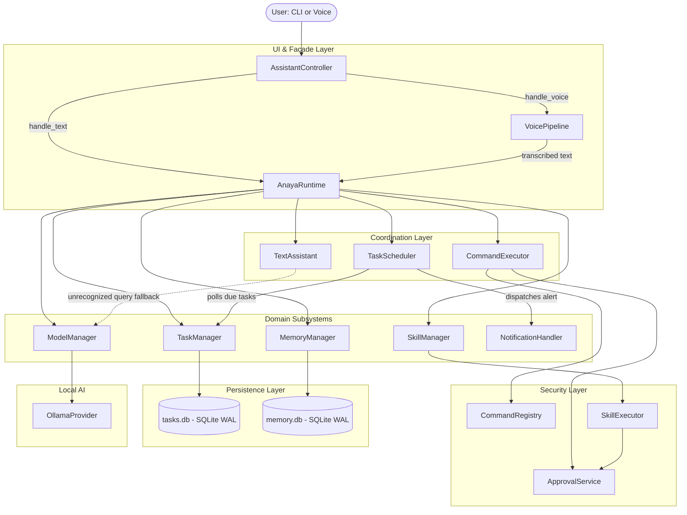
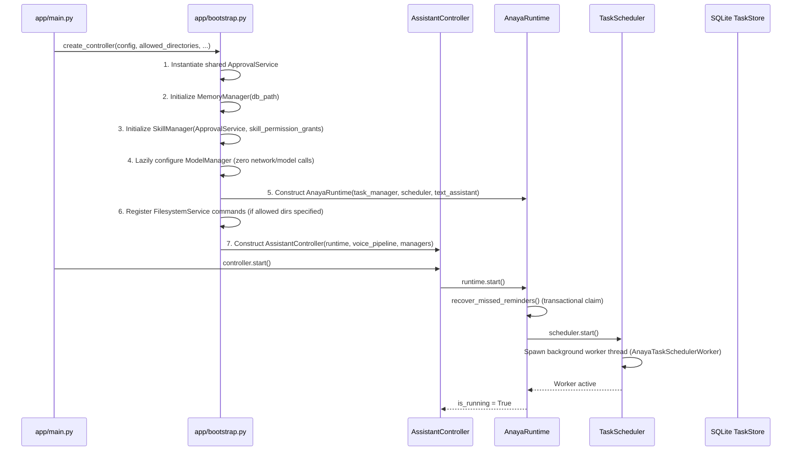
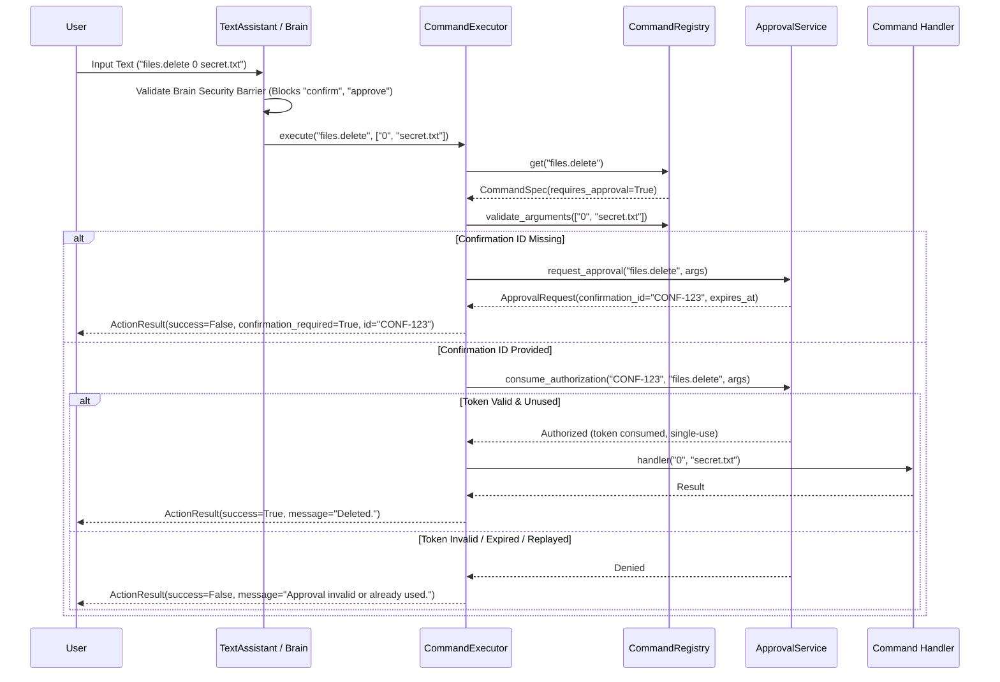
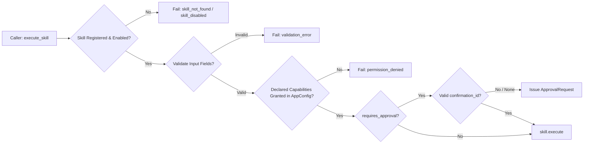
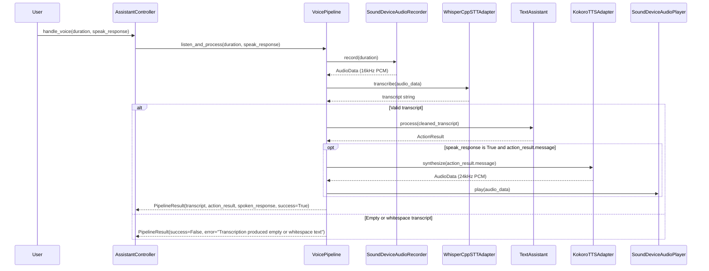
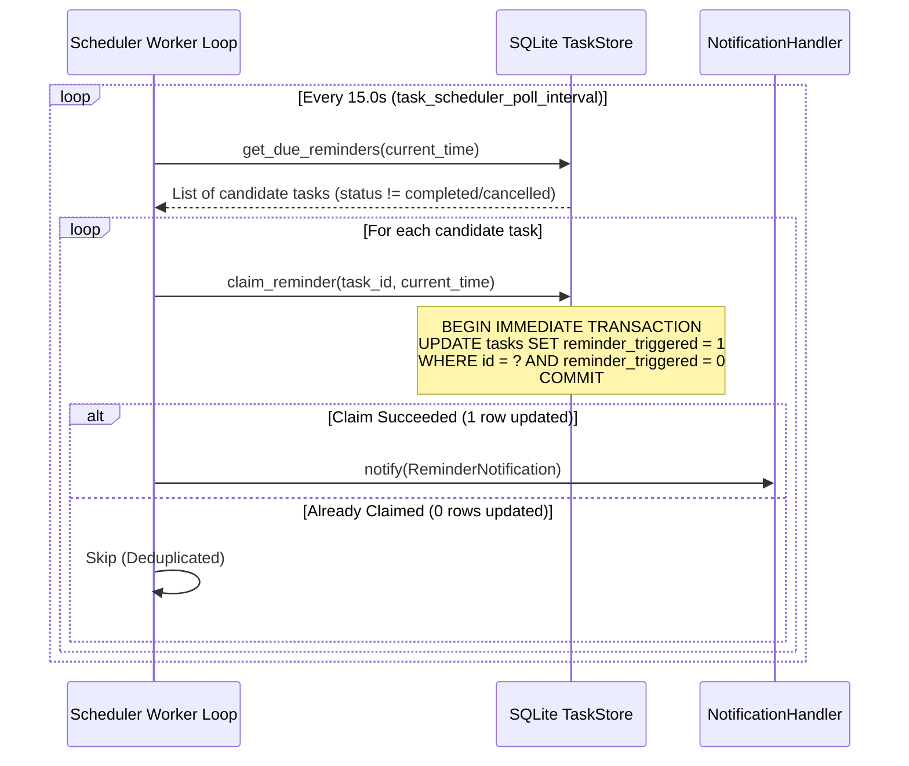
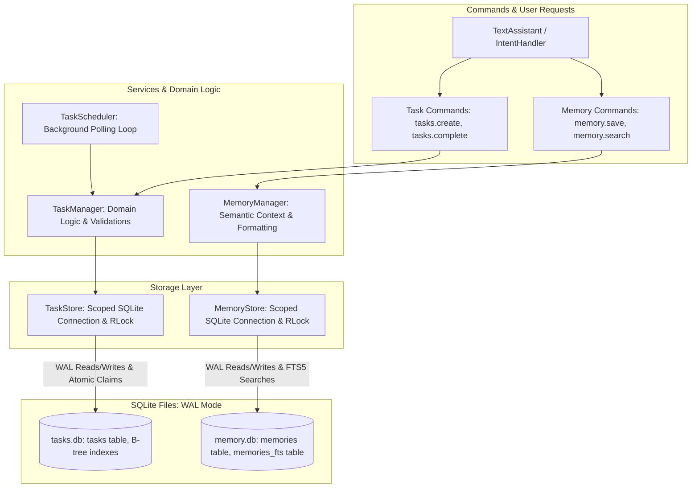

# Anaya — Current System Architecture

**Document Version:** 1.0.0  
**Repository State:** Phase 8B Completed  
**Release Commit:** `3026d3d`  
**Latest Verification:** 535 passed, 6 skipped, 0 failed (541 total items)  

---

## 1. Executive Overview & Design Philosophy

Anaya is an open-source, local-first personal AI assistant engineered for desktop environments. It delivers voice and text interaction, persistent SQLite-backed memory, task management with background reminder scheduling, a modular skills framework, and local LLM integration via Ollama—operating completely offline with zero mandatory cloud dependencies.

### Core Engineering Principles

1. **Local-First & Privacy-Preserving:**
   All state, tasks, memories, and conversational history reside in local SQLite databases. Local AI models run entirely on-device via Ollama. Network access is disabled by default (`internet_enabled: False`).
2. **Strict Dual-Execution Model (Deterministic vs. Non-Deterministic):**
   A rigid security barrier separates non-deterministic AI text generation from deterministic command execution. AI-generated text is strictly passive and treated as untrusted string output: it **cannot** invoke commands, approve actions, or bypass security validation.
3. **Fail-Closed Security & Authoritative Boundaries:**
   Commands execute through a single, allowlisted `CommandRegistry` and `CommandExecutor`. Sensitive operations require out-of-band, single-use, expiring approval tokens managed by an authoritative `ApprovalService`.
4. **Push-to-Talk & Zero Standing Audio Threads:**
   Zero microphone capture or audio processing threads run continuously in the background. Audio capture is bounded and activated strictly on-demand.
5. **Deterministic Concurrency & Resource Safety:**
   Background tasks (reminder scheduler) run on bounded threads with explicit lifecycle states (`start()`, `stop()`), synchronization locks, transactional at-most-once claims, and safe rollback on failure.

---

## 2. Complete Module Structure

```text
anaya/
├── app/
│   ├── __init__.py
│   ├── bootstrap.py              # Subsystem assembly & dependency injection factory
│   ├── controller.py             # AssistantController application facade & lifecycle coordinator
│   ├── main.py                   # Text CLI entry point & interactive REPL
│   ├── runtime.py                # AnayaRuntime coordinator (scheduler, commands, notifications)
│   ├── ai/                       # Local AI model management & Ollama integration
│   │   ├── __init__.py
│   │   ├── history.py            # Conversation history tracking with token/message bounds
│   │   ├── manager.py            # ModelManager coordinating providers, profiles, and fallback
│   │   ├── models.py             # ChatMessage, GenerationOptions, HardwareProfile, ModelSettings
│   │   ├── protocols.py          # ModelProvider protocol definition
│   │   ├── registry.py           # Allowlisted model definitions & hardware capability tiers
│   │   └── providers/
│   │       ├── __init__.py
│   │       └── ollama.py         # Ollama HTTP API provider client
│   ├── brain/                    # Natural language parsing & conversational routing
│   │   ├── __init__.py
│   │   ├── context.py            # ConversationContext tracking pending clarifications & history
│   │   ├── intent_handler.py     # Dispatches structured intents to executor or text responses
│   │   ├── models.py             # ParsedIntent, IntentType, ClarificationContext
│   │   ├── natural_parser.py     # Regex/heuristic parsing of natural text into CommandIntents
│   │   └── text_assistant.py     # Main conversational orchestrator & security barrier
│   ├── commands/                 # Deterministic command execution & domain command sets
│   │   ├── __init__.py
│   │   ├── executor.py           # CommandExecutor enforcing validation & approval consumption
│   │   ├── filesystem.py         # FilesystemService enforcing sandboxed path resolution
│   │   ├── filesystem_commands.py# Handlers for files.list, files.read, files.create, files.delete
│   │   ├── memory_commands.py    # Handlers for memory.save, memory.search, memory.list, etc.
│   │   ├── registry.py           # CommandRegistry with strict argument allowlisting
│   │   ├── skill_commands.py     # Handlers for skills.list, skills.run
│   │   └── task_commands.py      # Handlers for tasks.create, tasks.list, tasks.delete, etc.
│   ├── core/                     # Foundational primitives, configuration & logging
│   │   ├── __init__.py
│   │   ├── action_result.py      # Standardized ActionResult contract
│   │   ├── config.py             # AppConfig (frozen dataclass) and FrozenDict implementation
│   │   ├── exceptions.py         # Anaya core exception hierarchy
│   │   └── logger.py             # Structured application logging configuration
│   ├── memory/                   # Long-term persistent SQLite memory engine
│   │   ├── __init__.py
│   │   ├── memory_manager.py     # MemoryManager high-level facade
│   │   ├── memory_store.py       # MemoryStore SQLite storage backing (FTS5 + LIKE fallback)
│   │   └── models.py             # MemoryEntry, MemorySearchResult
│   ├── notifications/            # Task reminder notification delivery subsystem
│   │   ├── __init__.py
│   │   ├── handlers.py           # Logging, Callback, Composite, and Speech notification handlers
│   │   ├── models.py             # ReminderNotification immutable payload
│   │   └── protocols.py          # NotificationHandler protocol
│   ├── security/                 # Action approval, confirmation, and sanitization
│   │   ├── __init__.py
│   │   ├── approval_service.py   # Authoritative ApprovalService managing expiring authorizations
│   │   ├── confirmation.py       # ConfirmationManager generating bounded IDs & timestamps
│   │   ├── models.py             # ApprovalRequest, ConfirmationToken
│   │   ├── sanitizer.py          # Output and error sanitization routines
│   │   └── validator.py          # Strict path, filename, and argument validators
│   ├── skills/                   # Modular in-process skill extension framework
│   │   ├── __init__.py
│   │   ├── models.py             # Skill base class, SkillMetadata, SkillPermission, SkillResult
│   │   ├── skill_executor.py     # SkillExecutor enforcing capability gates & approval tokens
│   │   ├── skill_manager.py      # SkillManager facade for discovery, registry, and execution
│   │   ├── skill_registry.py     # Thread-safe in-memory registry of loaded skills
│   │   └── builtin/
│   │       ├── __init__.py
│   │       └── example_skill.py  # Built-in example.greeting skill
│   ├── speech/                   # Speech-to-text, text-to-speech, and audio I/O
│   │   ├── __init__.py
│   │   ├── models.py             # AudioData, PipelineResult, SpeechConfig
│   │   ├── pipeline.py           # VoicePipeline push-to-talk coordinator
│   │   ├── protocols.py          # AudioRecorder, AudioPlayer, SpeechToText, TextToSpeech
│   │   └── adapters/
│   │       ├── __init__.py
│   │       ├── kokoro_tts.py     # Kokoro-82M TTS engine adapter
│   │       ├── mock.py           # Deterministic mock speech adapters for test harnesses
│   │       ├── sounddevice_io.py # SoundDevice microphone recorder and audio player
│   │       └── whisper_cpp.py    # Whisper.cpp STT transcription adapter
│   └── tasks/                    # Task management, reminder scheduling, and SQLite store
│       ├── __init__.py
│       ├── date_parser.py        # TaskDateParser natural language datetime & recurrence parser
│       ├── models.py             # Task, TaskPriority, TaskStatus, TaskNotFoundError
│       ├── scheduler.py          # TaskScheduler background daemon worker thread
│       ├── task_manager.py       # TaskManager domain service coordinating task operations
│       └── task_store.py         # TaskStore SQLite storage backing with WAL mode
├── docs/                         # Project documentation and architectural records
└── tests/                        # Comprehensive test suite (unit, integration, E2E)
    ├── test_e2e/                 # End-to-end integration tests (CLI, persistence, scheduler, security)
    │   ├── conftest.py           # Shared fixtures: FakeClock, RecordingNotificationHandler, factory
    │   ├── test_e2e_cli.py
    │   ├── test_e2e_persistence.py
    │   ├── test_e2e_scheduler.py
    │   ├── test_e2e_security.py
    │   └── test_infrastructure.py
    ├── test_ai/
    ├── test_controller/
    ├── test_memory/
    ├── test_runtime/
    ├── test_skills/
    ├── test_speech/
    └── test_tasks/
```

---

## 3. High-Level Runtime Architecture



---

## 4. Application Lifecycle: Startup & Shutdown

### Startup Sequence (`bootstrap.create_controller()`)



### Shutdown Sequence (`controller.stop()`)

1. **Idempotency & Re-entry Guard:** Protected by an internal `RLock`. If already stopped, returns immediately.
2. **Scheduler Worker Signalling:** Signals `TaskScheduler._stop_event` and attempts to join the background worker thread within a bounded timeout (default 5.0 seconds).
3. **Safe Worker-Hang Handling (Phase 7B / 8B Invariant):**
   - If the scheduler worker thread remains alive after the timeout (e.g., blocked inside a user callback), `TaskStore` is **intentionally left open** to prevent SQLite `ProgrammingError: Cannot operate on a closed database` crashes.
   - `AssistantController` marks itself terminal but defers setting `_cleanly_stopped = True`.
   - A subsequent `controller.stop()` call after the thread exits finishes resource cleanup and sets `_cleanly_stopped = True`.
4. **Subsystem Teardown:**
   - Shuts down `VoicePipeline` and releases audio device streams.
   - Closes `MemoryStore` SQLite connections.
   - Unloads local AI model instances via `ModelManager.shutdown()`.
   - Closes `TaskStore` SQLite connections once the worker thread has safely terminated.

---

## 5. Command Execution & Security Architecture

Commands represent deterministic application actions (e.g., `tasks.create`, `files.delete`, `memory.save`, `skills.run`).



### The Six Security Boundaries

1. **Strict Command Allowlisting (`CommandRegistry`):** Only explicitly registered command names with exact arity and typed argument validators can execute. Unknown strings are rejected.
2. **Authoritative Out-of-Band Approvals (`ApprovalService`):** Sensitive actions require single-use authorization tokens. Natural language conversational prompts cannot satisfy confirmations. Tokens expire after 300 seconds and are bound to exact argument hashes.
3. **Filesystem Directory Sandboxing (`FilesystemService`):** Operations are confined to configured root directories (`allowed_directories`). Path traversal sequences (`..`), absolute path escapes, and symlinks resolving outside the sandbox are rejected fail-closed.
4. **Skill Capability Execution Gates (`SkillExecutor`):** Skills run in-process as trusted code. Permissions (`READ_ONLY`, `FILESYSTEM`) act as execution gates configured in `AppConfig.skill_permission_grants` using immutable `FrozenDict` mappings. Missing capabilities deny execution before approval requests or code invocation.
5. **AI Isolation:** Local LLM generation is completely isolated from command dispatch. Text produced by Ollama is returned as passive conversational output and never routed to `CommandExecutor` or `ApprovalService`.
6. **Data & State Atomicity:** Database writes use WAL mode and atomic SQLite transactions. Failed or rejected operations leave databases completely consistent.

---

## 6. Natural Language Processing & Brain Pipeline

The natural language layer (`app/brain/`) translates free-form text or transcribed voice into structured actions without allowing untrusted text to compromise execution safety.

```text
User Text
   │
   ▼
NaturalLanguageParser ──► Matches Regex & Heuristic Intent Patterns (tasks, memories, skills)
   │
   ├── [Matches Intent] ──► CommandIntent ──► CommandExecutor ──► Structured ActionResult
   │
   ├── [Ambiguous/Clarification] ──► ConversationContext ──► Prompts user for details
   │
   └── [No Command Pattern]
            │
            ├── AI Enabled? ──► ModelManager (Ollama) ──► Conversational Text Response
            │
            └── AI Disabled? ──► Static Help / "I didn't understand that command."
```

### Brain Security Barrier
To prevent conversational prompt injection or social engineering attacks:
- The parser strictly intercepts text affirmations like `"yes"`, `"confirm"`, `"approve"`, `"proceed"` if no active clarification context exists, returning:
  `"Text confirmation is disabled for sensitive actions. Use explicit confirmation commands."`
- Confirmation tokens must be passed through authoritative APIs or dedicated CLI confirmation commands.

---

## 7. Persistent Memory Engine

The Memory subsystem (`app/memory/`) provides long-term semantic persistence for notes, facts, and conversation context.

### Storage Architecture (`MemoryStore`)
- Backed by an isolated SQLite database (`memory.db`).
- Configured with `PRAGMA journal_mode=WAL`, `PRAGMA synchronous=NORMAL`, and `PRAGMA busy_timeout=5000`.
- **Full-Text Search:** Uses SQLite FTS5 (`memories_fts` virtual table with content triggers) for fast keyword and prefix queries.
- **Graceful Fallback:** If SQLite was compiled without FTS5 extension support, the engine automatically detects the error at startup and falls back to parameterised SQL `LIKE` substring queries transparently.
- **Isolation:** Operates independently of the task database, ensuring corrupted task operations cannot impact memory integrity.

---

## 8. Modular Skills Framework

The Skills subsystem (`app/skills/`) allows modular, contract-driven capabilities to be registered and invoked.



### In-Process Execution Gate Semantics
- **Execution Gates, Not Sandboxes:** Skills execute in-process as trusted Python code. Permissions (`SkillPermission.READ_ONLY`, `SkillPermission.FILESYSTEM`) act as logical authorization gates enforced by `SkillExecutor`. They do not provide operating-system or memory-level isolation.
- **Immutable Capability Configuration:** Configured per-skill via `AppConfig.skill_permission_grants` using `FrozenDict`. Empty dictionary overrides (`skill_permission_grants={}`) override config fail-closed.
- **Defensive Snapshot:** `SkillExecutor` makes an immutable `frozenset` defensive copy of all capability grants upon instantiation; subsequent mutations of external configuration objects have zero effect on active executors.

---

## 9. Speech & Audio Engine

The Speech subsystem (`app/speech/`) provides bounded push-to-talk voice interaction.

### Push-to-Talk Execution Flow



### Pipeline Components (`VoicePipeline`)
1. **Audio Recording (`SoundDeviceAudioRecorder`):** Captures 16 kHz or 24 kHz mono 16-bit PCM audio from the default system microphone. Recording is strictly bounded by duration or keypress release.
2. **Speech-to-Text (`WhisperCppSTTAdapter`):** Local transcription running via `whisper.cpp` bindings or command-line wrappers. Zero external audio transmission.
3. **Intent Routing:** Transcribed text feeds directly into `AssistantController.handle_text()`.
4. **Text-to-Speech (`KokoroTTSAdapter`):** Synthesizes response text into 24 kHz audio using the local Kokoro-82M model.
5. **Audio Playback (`SoundDeviceAudioPlayer`):** Plays audio waveforms aloud through default system speakers.
6. **Graceful Degradation:** If optional speech libraries (`sounddevice`, `numpy`) or hardware devices are missing, the pipeline returns structured `PipelineResult(success=False)` errors without terminating the application.

---

## 10. Tasks, Reminders & Background Scheduling

The Task subsystem (`app/tasks/` and `app/notifications/`) manages persistent tasks, deadlines, and background reminder delivery.

### At-Most-Once Delivery Guarantee


- **Atomic Claim:** Deduplication is enforced at the database layer via atomic SQL transactions (`UPDATE tasks SET reminder_triggered = 1 WHERE id = ? AND reminder_triggered = 0`). Only the single execution thread that successfully changes the row delivers the notification.
- **Startup Recovery (`recover_missed_reminders`):** During `runtime.start()`, any past-due reminders that fired while the application was offline are queried, atomically claimed with `is_missed=True`, and dispatched immediately.
- **Terminal Task Exclusion:** Completed and cancelled tasks are excluded from reminder eligibility.

---

## 11. Local AI & Model Switcher

The AI subsystem (`app/ai/`) integrates on-device LLMs via Ollama.

- **Hardware Capability Detection:** `HardwareProfile` checks CPU thread count, total system memory, and available VRAM to determine system tier (`low`, `balanced`, `high`).
- **Profile-Driven Models:** Maps profile tiers to suitable local models (e.g., `qwen2.5:0.5b`, `llama3.2:1b`, `llama3.2:3b`, `qwen2.5:7b`).
- **Lazy Initialization:** Zero HTTP requests, model pulls, or memory allocations occur during application bootstrap. Model connections are established only on the first explicit conversational query.
- **History Management:** `ConversationHistory` manages multi-turn dialogue with token estimation, message truncation, and context window pruning.

---

## 12. SQLite Database Architecture

### Data Flow (Tasks & Memory)



| Attribute | `tasks.db` | `memory.db` |
| :--- | :--- | :--- |
| **Domain** | Tasks, due dates, reminder scheduling, claim state | Notes, facts, semantic context |
| **Journal Mode** | `WAL` (Write-Ahead Logging) | `WAL` (Write-Ahead Logging) |
| **Synchronous** | `NORMAL` | `NORMAL` |
| **Busy Timeout** | 5000 ms | 5000 ms |
| **Search Engine** | Standard B-Tree indexing on `reminder_at`, `status` | FTS5 Full-Text Virtual Table (with `LIKE` fallback) |
| **Connection Pattern** | Scoped connection per store instance with `RLock` | Scoped connection per store instance with `RLock` |

---

## 13. Configuration Architecture & Immutability

Application settings are declared in `AppConfig` (`app/core/config.py`), a frozen dataclass (`@dataclass(frozen=True)`).

### `FrozenDict` Implementation
To ensure complete immutability for dictionary configuration fields like `skill_permission_grants`:
- `FrozenDict` inherits from `dict[str, tuple[str, ...]]` to preserve standard dictionary interfaces, `dataclasses.asdict()`, `json.dumps()`, and `copy.deepcopy()` compatibility.
- Rejects all 8 mutating methods and operators with `TypeError`:
  - `__setitem__`, `__delitem__`, `__ior__` (`|=`), `clear`, `pop`, `popitem`, `setdefault`, `update`.
- Normalizes all nested permission sequences into immutable tuples `tuple[str, ...]`.
- Constructor in `bootstrap.py` uses explicit `None` handling:
  - Passing `None` falls back to `AppConfig.skill_permission_grants`.
  - Passing `{}` overrides configuration and denies all permissions fail-closed.

---

## 14. Testing Architecture & Infrastructure

Anaya features a deterministic, multi-layered test pyramid running under `pytest`.

```text
┌──────────────────────────────────────────────┐
│        End-to-End Tests (tests/test_e2e/)    │  52 tests (CLI, Persistence, Scheduler, Security)
├──────────────────────────────────────────────┤
│        Integration Tests (tests/test_*)      │  Subsystem interactions, runtime, controllers
├──────────────────────────────────────────────┤
│        Unit Tests (tests/test_*)             │  Pure component logic, parsers, validators
└──────────────────────────────────────────────┘
```

### Deterministic Test Infrastructure (`tests/test_e2e/conftest.py`)
- **`FakeClock`:** Thread-safe simulated UTC clock allowing deterministic time travel and advancement without real-time sleeps.
- **`RecordingNotificationHandler`:** Thread-safe recording handler utilizing `threading.Event` signaling for instant synchronization with background scheduler threads.
- **`e2e_controller_factory`:** Fixture managing temporary isolated SQLite database paths (`temp_anaya_dir`) and automated reverse-order teardown with bounded shutdown timeouts and clean stop verification.

---

## 15. Known Technical Debt & Current Limitations

1. **In-Process Skill Execution:**
   Skills execute in the same Python process as the core runtime. Malicious or poorly written skills could consume CPU cycles or execute unauthorized system calls. True sandboxing will require out-of-process isolation (containers or subprocess workers).
2. **Windows Symlink Test Requirement (`[WinError 1314]`):**
   Creating filesystem symlinks on Windows requires Developer Mode or `SeCreateSymbolicLinkPrivilege`. When executed in unprivileged Windows developer environments, the symlink security test safely skips with a clear diagnostic explanation.
3. **Single Background Scheduler Worker:**
   Reminder dispatching runs sequentially in a single worker thread. Slow notification handlers (e.g., synchronous network webhooks or blocking audio playback) can delay subsequent reminder checks. Handlers should offload heavy work to worker pools.
4. **Natural Language Parser Heuristics:**
   `NaturalLanguageParser` uses regular expressions and heuristic keyword matching. Complex or colloquial task phrasing that falls outside established regex rules routes to AI fallback or fails to extract structured arguments.
